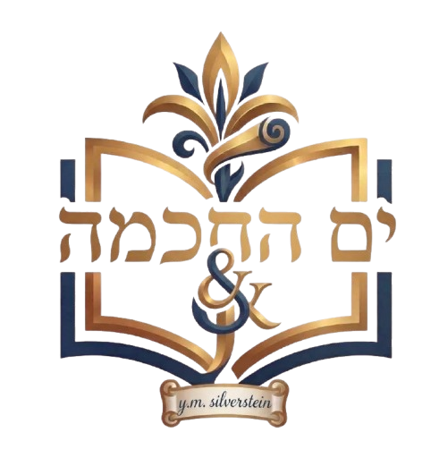

# ים החכמה → אוצריא

כלי ההמרה עברו ל־[book-sources](https://github.com/Otzaria/book-sources/tree/main/yam-HaHachmaToOtzaria/סקריפטים/). מריצים אותם משם עם נתיבי קלט ופלט מפורשים אל הספרייה הזאת. את `.claude/skills/otzaria-book-format/scripts/validate_book.py` מריצים מתוך checkout של otzaria-library, אחרי ההמרה. הספרים, הקרדיט, הרישיון, הלוגו והמטא־דאטה נשארים כאן.

ספרים ממאגר הספרים התורני **["ים החכמה"](https://github.com/torahtyh/yam-HaHachma)**.

## הרישיון ומה הוא מחייב אותנו

נוסח מלא: [LICENSE-yam-HaHachma.md](LICENSE-yam-HaHachma.md). העתקה למאגרים
תורניים **חינמיים** מותרת בלי רשות מראש, בכפוף לארבעה תנאים:

| התנאי | איפה אנחנו עומדים בו |
| --- | --- |
| קרדיט למאגר + קישור בכל ספר שהועתק — והרישיון מוסיף ש**אין צורך** לקרדיט בגוף הספר | סעיף "ים החכמה" ב-[README.md](../README.md) הראשי, ומסך "אודות הספר" באפליקציה. אין `BookSourceBanner` — במכוון |
| שם המאגר והלוגו בקטגוריה שבה מוצגים הספרים | `book_source_dialog.dart` ו-`about_settings_data.dart` ב-repo התוכנה; הלוגו נארז כ-`assets/logo_books/yam_hahachma_logo.png` |
| להעתיק את **כל** ספרי המאגר ולא לברור מתוכם, למעט כפילויות וספרים שכבר יש לנו | הועתקו כולם |
| להעביר להם הערות ותיקונים | `emailRecipientsFor` ב-`error_report_dialog.dart` שולח דיווח על ספר מהמקור הזה גם ל-`y025837086@gmail.com` וגם אלינו |

שם המקור ב-`seforim.db` הוא **`yam-HaHachmaToOtzaria`** — הוא נגזר אוטומטית מרכיב
הנתיב הראשון של מפתחות `files_manifest.json` (`Generator.kt` ב-SeforimLibrary),
ולכן אין צורך לרשום אותו בשום מקום ב-SeforimLibrary.

## אם מושכים מהם עדכון

תנאי הרישיון נוגעים להיקף ההעתקה בנקודת ההעתקה, ו**אין בהם דרישה לסנכרון מתמשך**.
משיכת עדכון היא החלטה שלנו. כשמחליטים לעשות זאת:

1. `git pull` על העותק המקומי של [yam-HaHachma](https://github.com/torahtyh/yam-HaHachma).
2. לכל ספר חדש: להריץ את הכלים שב-[scripts/](https://github.com/Otzaria/book-sources/tree/main/yam-HaHachmaToOtzaria/סקריפטים/) ואחריהם
   `.claude/skills/otzaria-book-format/scripts/validate_book.py` עד 0 שגיאות.
3. `make_metadata.py --check-name` **לפני** שקובעים שם קובץ — התנגשות שם עם ספר
   קיים היא שגיאה קשה שמפילה את האריזה (כך נולד השם `הליכות עולם - כללי הגמרא`).
4. להוסיף רשומה ל-`metadata.json`, `all_metadata.json`,
   `all_metadata_with_file_paths.json`, `ForDB/all_metadata.json`
   ושורה ל-`ForDB/book_info.csv`.

## התאמות שנדרשו לספרים

המאגר כבר מעוצב בסגנון אוצריא (`<h1>`–`<h3>`, `<b>`, שורה = יחידת תוכן), אבל שתי
תקלות חזרו בו:

* **כותרות באמצע שורה** — `<hN>` שנדבק לסוף פסקה או שנשאר לו טקסט אחריו. אוצריא
  מזהה כותרת רק בתחילת שורה, וטקסט שאחרי `</hN>` נבלע לשם הכותרת בתוכן העניינים.
  תיקון: [scripts/split_inline_headings.py](https://github.com/Otzaria/book-sources/tree/main/yam-HaHachmaToOtzaria/סקריפטים/split_inline_headings.py).
* **כותרות תלושות** — מילה או אות שהיא חלק מהמשפט וקיבלה `<hN>` רק כי בדפוס היא
  הודפסה בשורה נפרדת. תיקון: [scripts/unwrap_stray_headings.py](https://github.com/Otzaria/book-sources/tree/main/yam-HaHachmaToOtzaria/סקריפטים/unwrap_stray_headings.py).

שני הכלים משנים **חלוקת שורות ותגים בלבד** — לא מילה מלשון הספר.

* **שורות דפוס במקום פסקאות** — `חזון איש חושן משפט, נזיקין` (נמשך בספטמבר 2026)
  הגיע כ-OCR גולמי: שורה לכל שורת דפוס, ובליקוטים גם סימני עמוד, כותרות רצות ומילות
  קישור. תיקון: [scripts/chazon_ish_nezikin_reflow.py](https://github.com/Otzaria/book-sources/tree/main/yam-HaHachmaToOtzaria/סקריפטים/chazon_ish_nezikin_reflow.py)
  (57 אלף שורות → 5,320, עם בדיקת שימור טקסט). נשמר בשם `חזון איש, חושן משפט נזיקין`,
  כדי להתיישר עם שאר כרכי חזון איש שב-MoreBooks, שבאותה תיקייה.
* **טקסט גולמי בלי תגים** (נמשכו באוקטובר 2026):
  * `שדי חמד כללים מערכת ע` — `כלל X)` בתחילת שורה במקום `<h3>`. תיקון:
    [scripts/shdei_chemed_raw_kelalim.py](https://github.com/Otzaria/book-sources/tree/main/yam-HaHachmaToOtzaria/סקריפטים/shdei_chemed_raw_kelalim.py)
    (`<h1>`/`<h2>`/`<h3>` כמו במערכות נ ו-ס, מספרי כללים מנורמלים בכותרת בלבד).
    אותו סקריפט הוסב גם למערכות פ, צ, ק, ר, ש, ת, ל (נמשכו באוקטובר 2026): `יו"ד` כמספר 10,
    כללים מעל 99 (ש מסתיימת בכלל ק), `[כלל X)]` בסוגריים מרובעים, והערת עורך
    ("צריך לתקן הרבה שגיאות כאן") שלפני כותרת מערכת ק הושמטה. מערכת צ מסתיימת במקור בכלל יב.
  * `שדי חמד כללים מערכת ל` — אותו סקריפט. הרצף במקור קטוע: אחרי כלל לה בא כלל ס"ג, ובהמשך
    חסרים גם כלל קג וכלל קמב (115 כללים בקובץ). זה מצב המקור, ולא הושלם כלום.
  * `ספר המנהיג` (`הלכה/ראשונים`) — OCR של דפוס בשורות של כ־75 תווים, בלי תגים. תיקון:
    [scripts/hamanhig_reflow.py](https://github.com/Otzaria/book-sources/tree/main/yam-HaHachmaToOtzaria/סקריפטים/hamanhig_reflow.py) (8,228 שורות → 757, עם
    בדיקת שימור טקסט): `<h2>` לכותרות החלקים (`דיני תפלה`, `הלכות שבת` וכו' — 27), פסקה חדשה
    בכל סעיף ממוספר (`א)`) ואחרי שורה קצרה שנגמרת בנקודה/נקודתיים. נמחקו 65 שורות: רעש של
    הסריקה (`Digitized by Google`, פיסוק וספרות בודדים) ו־8 סמני עמוד רצים (`[המנהיג] ב 2`);
    וכן 76 מילות מעבר (המילה הראשונה של העמוד הבא, שהודפסה בתחתית העמוד ו־OCR העתיק לשורה
    משלה; נמחקו רק כשהן זהות בדיוק למילה שאחרי מעבר העמוד). מילות מעבר שה־OCR שיבש
    לא נמחקו (כ־60). שגיאות OCR בגוף הטקסט ובמספור הסעיפים (`ינ` במקום `יג`, שני סעיפי `ו`)
    לא תוקנו. הכותרת `ספר המנהיג` שבשורה 1 של המקור זהה ל־`<h1>` ולכן נמחקה; המחבר
    (רבי אברהם בן נתן הירחי) נוסף על ידינו.
  * `ילקוט מעם לועז` — ארבעה כרכים (בראשית, שמות, ויקרא, במדבר; `מדרש/אגדה/ילקוט מעם לועז`;
    חסר הכרך על חומש דברים). נמשכו באוקטובר 2026 (`dddc11a`) בשם `…_נקי`, ובנובמבר 2026
    (`525d44c`) הוחלפו במקור בנוסח מתוקן (בשם `ילקוט מעם לועז <חומש>.txt`, שבו הוסרו רוב
    ההפניות `(א)` ורשימות המקורות), ובכרך שמות תוקן שוב ב־`6131106` (5.11.2026); הספרייה מחזיקה את הנוסח
    המתוקן, תחת השמות `ילקוט מעם לועז - <חומש>`.
    עדיין טקסט גולמי בשורות דפוס של כ־65 תווים, בלי תגים. תיקון:
    [scripts/meam_loez_reflow.py](https://github.com/Otzaria/book-sources/tree/main/yam-HaHachmaToOtzaria/סקריפטים/meam_loez_reflow.py) (12–47 אלף שורות → 1,439–4,037 לכרך,
    עם בדיקת שימור טקסט): `<h2>` לפרשה ו־`<h3>` ל־`פרק X`; פסקה חדשה אחרי שורה קצרה (<56 תווים)
    שנגמרת בסימן סוף משפט ואחרי פסוק מצוטט שנגמר ב־`(א, א)` (ובפסקה שעברה 2,000 תווים — גם אחרי
    שורה של פחות מ־64 תווים); ברשימות `מקורות:` שנשארו (בעיקר בכרך שמות) כל פריט `(א) …` בשורה נפרדת.
    נמחקו כותרות עמוד רצות (`ילקוט מעם לועז - שמות`) ומספרי עמוד (אות־מספר לבדה ליד שורה ריקה),
    כולן מודפסות בהרצה. כותרות הפרשה חסרות במקור בכחצי מהמקרים (נשאר רק `ביאור פרשת X והיא בספר
    תורה …` לפני `פרק א`, ובמשפטים — בסוף אותה שורה): הסקריפט יוצר מהן `<h2>פרשת X</h2>`, ובפרשת
    פקודי — שאין בה אזכור כזה — הכותרת מוגדרת ב־`MISSING` בסקריפט. כותרת הכרך נקבעת בסקריפט,
    ובכרך בראשית `בראשית` הפכה ל־`פרשת בראשית`. המקור לא מציין מחבר; נרשם
    רבי יעקב כולי, מחבר "מעם לועז", על דעתנו — כדאי לאשר. בכרך שמות אין כותרת לפרשת כי תשא
    (כך במקור). פסקאות רבות ארוכות (עד אלפי תווים), כי המקור אינו מסמן סוף פסקה. שגיאות OCR
    (`ח׳` במקום `ה׳`, `זיקם` במקום `ויקם`) לא תוקנו; מספרי עמוד ששובשו נמחקו כשבאו ליד שורה ריקה,
    וכותרת עמוד ששובשה מעבר לצורות המוכרות נשארה בטקסט.
  * `שות ושב הכהן` (`שות/אחרונים`) — כבר מתויג (`<h1>`, `<h2>סימן …`, מילה ראשונה של כל פסקה
    ב־`<b>`) אבל בשורות דפוס של כ־50 תווים. תיקון:
    [scripts/vesheiv_hakohen_reflow.py](https://github.com/Otzaria/book-sources/tree/main/yam-HaHachmaToOtzaria/סקריפטים/vesheiv_hakohen_reflow.py) (40,174 שורות → 1,449;
    פסקה חדשה בכל שורה שנפתחת ב־`<b>`; הכותרת `<h2>סימן פא` שנקטעה במקור בשורה אחת
    אוחדה). המקור לא מציין מחבר; נרשם רבי רפאל כהן (1722–1803, אב״ד אלטונה), לפי רשומת הספרייה של פרינסטון
    על ההדפסה החוזרת של דפוס אלטונה תקנ״ב, ובאישור.
  * `פחד יצחק חלק ט` — OCR בשורות דפוס, בלי סימון פסקה. תיקון:
    [scripts/pachad_yitzchak_reflow.py](https://github.com/Otzaria/book-sources/tree/main/yam-HaHachmaToOtzaria/סקריפטים/pachad_yitzchak_reflow.py)
    (7,414 שורות → 1,321 פסקאות, עם בדיקת שימור טקסט). אין כותרות לערכים, כי גבול
    המילה הראשית אינו מסומן בטקסט. לפניו
    [scripts/pachad_yitzchak_ocr_fix.py](https://github.com/Otzaria/book-sources/tree/main/yam-HaHachmaToOtzaria/סקריפטים/pachad_yitzchak_ocr_fix.py) מתקן מול
    הסריקה (HebrewBooks 20343) 910 טעויות OCR (בעיקר ר→ד, ב→כ, ם→ס) ו־49 שורות סיום
    שהוצבו אחרי תחילת הערך הבא, ומסיר ניקוד שהוא כתמי דיו. הרצה:
    `pachad_yitzchak_ocr_fix.py RAW.txt OUT.txt` (מריץ את ה־reflow בעצמו).
  * `פחד יצחק חלק י` (אותיות ק–ר; נמשך בנובמבר 2026; שורה 1 במקור `פחד יצחק אות ק`) — OCR בשורות
    דפוס בלי סימון פסקה. תיקון: [scripts/pachad_yitzchak_yod_reflow.py](https://github.com/Otzaria/book-sources/tree/main/yam-HaHachmaToOtzaria/סקריפטים/pachad_yitzchak_yod_reflow.py)
    (14,752 שורות → 1,304, עם בדיקת שימור טקסט): נמחקו 107 מספרי עמוד (אות־מספר לבדה, לפי רצף
    העמודים) ו־21 שורות זבל של OCR; פסקה חדשה בכל `אות X.` ואחרי שורה קצרה שנגמרת בנקודה/נקודתיים.
    להבדיל מחלק ט, שגיאות ה־OCR לא תוקנו מול הסריקה (HebrewBooks חסום לגישה אוטומטית).
    שם המחבר כצורתו הנעולה בחלק ט.
  * `דברי אמת (דרשות)` (`תנך/דרשות ודרושים`; בתיקיית השורש של המקור, בלי קטגוריה; נמשך בנובמבר 2026) —
    חמש עשרה דרשות (ה'תק"ג–ה'תק"י לערך) ב־OCR בשורות דפוס, בלי שער ובלי מחבר במקור; המחבר (רבי יצחק בן דוד מקושטנטינא, המוזכר בנודע ביהודה סימן ע"ב) נוסף לפי דיווח משתמש. **אינו ספר
    `דברי אמת` של החוזה מלובלין שבספריא** (שם אחר, ה־`(דרשות)` מבחין). תיקון:
    [scripts/divrei_emet_reflow.py](https://github.com/Otzaria/book-sources/tree/main/yam-HaHachmaToOtzaria/סקריפטים/divrei_emet_reflow.py) (10,226 שורות → 302): `<h2>` לכל
    דרוש (מיקומי הכותרות קבועים בסקריפט, כי ה־OCR שיבש חלק מהן ולדרוש השישי אין כותרת מספרית),
    נמחקו קווי הפרדה וסימני עמוד שבורים (22 שורות), פסקה חדשה אחרי שורה קצרה שנגמרת בנקודה/נקודתיים.
    **המחבר לא זוהה** — שורה 2 ריקה ו־`author` ריק; כדאי לזהות (בדרשות נזכרים מהר"ר חיים אבולעפיא
    ומהר"ר חיים ן' עטר, והגביר דוד זונאנא).
  * `הגהות רבי העשיל על הסמג` — שורות דפוס בלי סימון הגהות. תיקון:
    [scripts/heshil_semag_reflow.py](https://github.com/Otzaria/book-sources/tree/main/yam-HaHachmaToOtzaria/סקריפטים/heshil_semag_reflow.py) (1,188 שורות → פסקאות
    לפי `. שם ` / `. דף ` ושורה קצרה שנגמרת בנקודה; שתי כותרות החלק ל־`<h2>`; הוסרו
    כותרות עמוד רצות; עם בדיקת שימור טקסט). גבולות ההגהות אינם מסומנים במקור, ולכן
    החלוקה משוערת.
* `הליכות עולם - כללי הגמרא` (`ספרות עזר/כללי השס`) — מעמוד 198 ועד הסוף (כ־1,600 מתוך 1,805
  שורות) כל פסקה שבורה במקור לשורות של כ־75–80 תווים, וסוף הפסקה הוא שורה קצרה; תחילת הספר
  כבר שורה־לפסקה. תיקון: `halichot_olam_reflow.py` (בריפו [book-sources](https://github.com/Otzaria/book-sources), `yam-HaHachmaToOtzaria/סקריפטים/`)
  (1,805 שורות → 590). השורות מתחברות כשהמילה הבאה לא הייתה נכנסת בשורה ושהשורה אינה נגמרת
  בסימן סיום; 63 הזוגות שבהם שורה מלאה נגמרת בנקודה (סוף משפט או סוף פסקה?) הוכרעו אחד־אחד
  לפי התוכן — 17 חוברו, 46 נשארו נפרדים (רשימות כללים, דורות, פריטים ממוספרים, תבליטים).
  נמחקו גם שני זוגות שאריות עמוד באמצע הטקסט (`69 ---`/`71`, `76 ---`/`78`), אחד מהם קטע
  משפט. אין לספר קובצי קישורים או כותרות לוואי, ולכן לא היה מה להזיז. בדיקת שימור: אותם
  טוקנים בדיוק, פרט לסימני העמוד. **משיכה מחדש של הקובץ ממקור ים החכמה תשחזר את השבירה.**
  הכרעות העמומים צמודות למספרי השורות של הקלט (הסקריפט נעצר אם ה־sha256 שונה), ולכן אחרי
  משיכה כזו צריך להריץ את הכלל מחדש ולהכריע את העמומים שוב.
* `זכרון לאברהם` הגיע בלי `<h1>` ובלי מחבר (הכותרת הייתה `<h2>` עם `*)` להערה שבסוף):
  נוספו `<h1>` ושורת מחבר, `<h3>` הורד ל־`<h2>`, וה־`*)` עבר לשורת ״חידושים על
  המשניות״. הטקסט לא שונה.

